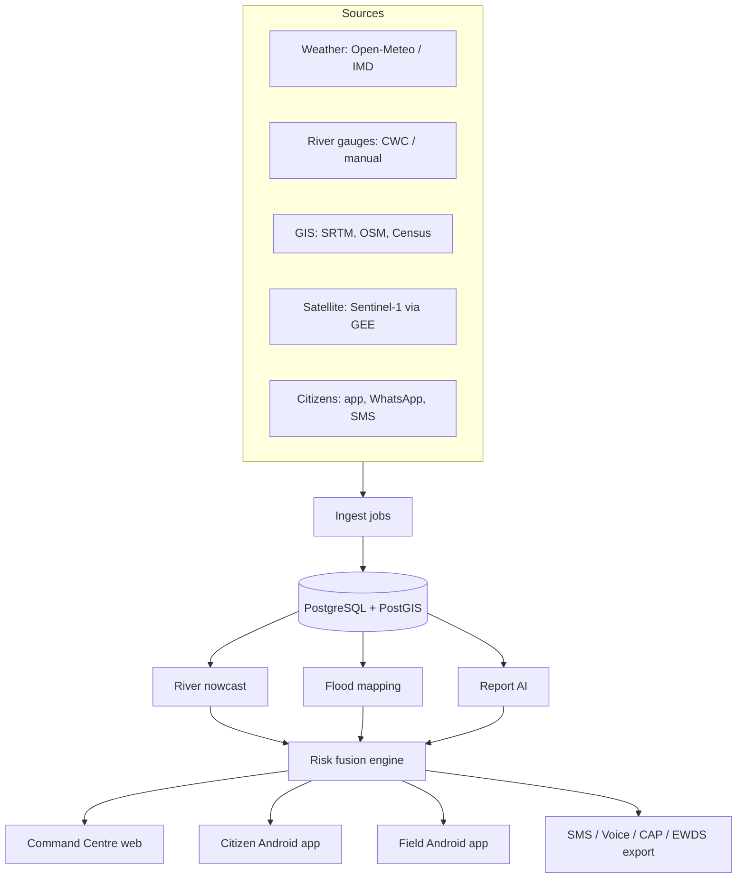

# DRISHTI Ganjam — Product Requirements Document (PRD)

**AI-Based Hyperlocal Disaster Intelligence System for Ganjam district, Odisha**
OSFIC 2026 · Problem Statement **PS-074** · Theme: Disaster Management · Track 1 (Student Innovator)

| Field | Value |
|---|---|
| Product name | DRISHTI Ganjam (ଦୃଷ୍ଟି) |
| Team | TeamGanjam |
| Lead developer | Sameer Swain — B.Tech CSE, 7th semester |
| Institute | Sanjay Memorial Institute of Technology (SMIT), Berhampur, Ganjam, Odisha |
| Mentor | Er. Kiran Kumar Sethi |
| Competition | Odisha Seva First Innovation Challenge (OSFIC) 2026, Startup Odisha & MSME Dept., Govt. of Odisha |
| PRD version | 1.0 · 01 Nov 2026 |
| Builder | Claude Code (agentic build), reviewed by Sameer Swain |

> **For Claude Code:** Read `CLAUDE.md` first, then this whole PRD. Build in the milestone order of §17. Every milestone has a Definition of Done (DoD); do not start the next milestone until the current one passes its DoD. The `reference/` folder holds a working HTML prototype (`reference/prototype/index.html`) — it is the **visual and behavioural reference** for all three apps. Seed data is in `seed/`. Everything must run **fully offline in DEMO MODE** with `docker compose up` and no paid keys (§12).

---

## Table of contents

1. Problem statement and context
2. Goals, non-goals, success metrics
3. Users, personas and roles (RBAC)
4. Product overview — one system, three apps
5. Core concepts and domain glossary
6. Functional requirements — backend modules
7. Functional requirements — Command Centre (web)
8. Functional requirements — Citizen app (Android)
9. Functional requirements — Field Responder app (Android)
10. Messaging channels — SMS, voice, WhatsApp, CAP
11. AI / ML specification
12. Demo mode, scenario replay and simulation
13. Technical architecture and stack
14. Data model (PostgreSQL + PostGIS)
15. API specification (REST + WebSocket)
16. Non-functional requirements (security, privacy, performance, accessibility, offline)
17. Build plan for Claude Code — milestones with Definition of Done
18. Testing and acceptance
19. Competition deliverables (OSFIC) and demo script
20. Risks, assumptions, open questions
21. Appendices — seed data, lexicons, Odia strings, CAP sample, scoring math

---

## 1. Problem statement and context

### 1.1 Official problem statement (PS-074, verbatim)

> AI-Based Hyperlocal Disaster Intelligence System: Develop a multimodal AI system that combines weather and rainfall data, GIS information, satellite imagery, and citizen-reported images/text to detect and predict localized flood and cyclone impacts in Ganjam, identify vulnerable locations, and provide actionable risk alerts for emergency response and resource allocation.
> — Department/Institution: NIST University

Every requirement in this PRD traces to one of these clauses:

| PS-074 clause | Where it is satisfied |
|---|---|
| weather and rainfall data | §6.3 ingestion, §11.2 nowcast |
| GIS information | §6.2 geography, §6.4 exposure/vulnerability |
| satellite imagery | §6.3.4, §11.3 flood mapping |
| citizen-reported images/text | §6.6 reports, §11.4 report AI, §8 citizen app |
| detect and predict localized flood and cyclone impacts | §6.4 risk engine, §6.5 forecast |
| identify vulnerable locations | §6.4 exposure + vulnerability, village layer |
| actionable risk alerts | §6.8 alerts, §10 channels |
| emergency response and resource allocation | §6.7 SOS/tasks, §6.9 allocation, §9 field app |

### 1.2 Why it matters (real events — use in UI copy and pitch)

- **Cyclone Titli, Oct 2018:** winds did limited damage in Ganjam but the rain that followed caused floods. The Rushikulya at Purushottampur crossed its 16.83 m danger mark and reached 18.60 m. 13 of Ganjam's 22 blocks were badly hit; villages were cut off and Navy helicopters dropped relief. People returning early from a cyclone shelter in Sorada were swept away; a child drowned in a canal in Hinjili; 105 pregnant women in Ganjam were shifted to hospitals.
- **Cyclone Phailin, Oct 2013:** landfall near Gopalpur (Ganjam); a 3–3.5 m storm surge was forecast for low-lying coastal areas; about 2.5 lakh houses were damaged in the district.

### 1.3 The gap DRISHTI fills

1. **Late detection** — post-cyclone river floods arrive hours later; warnings focus on wind at district level.
2. **Fragmented data** — rain, river gauges, satellite and citizen messages live in separate places.
3. **Lost citizen signals** — WhatsApp photos and Odia messages are not read, mapped or prioritised.
4. **Guess-based resource allocation** — boats and teams go where calls are loudest, not where risk is highest.

### 1.4 Existing systems — DRISHTI integrates, does not compete

| System | Owner | What it does | DRISHTI relationship |
|---|---|---|---|
| SATARK | OSDMA + RIMES | Location-specific impact advisories; web + Android | Complementary; future data exchange API |
| EWDS | OSDMA | 122 alert towers in 6 coastal districts incl. Ganjam; DMR radio SEOC↔DEOC↔BEOC; mass messaging | Approved DRISHTI alerts can be pushed to EWDS operators (export) |
| SACHET | NDMA | CAP-based alerts via SMS/app/RSS, mostly district polygons | DRISHTI exports **block/village-level CAP 1.2** alerts |

---

## 2. Goals, non-goals, success metrics

### 2.1 Goals (v1.0 — competition + pilot-ready)

- G1. Hourly 0–100 risk score with reasons for each of Ganjam's 22 blocks (and villages where data exists).
- G2. AI early warning: predict which block becomes Severe within the next 12 h, with hours-to-severe.
- G3. Citizen reporting (text + photo, Odia/Hindi/English) with automatic triage into place, hazard, severity, needs.
- G4. Closed rescue loop: Citizen SOS → Command Centre → Field team → "Rescued" back to citizen, in real time.
- G5. Officer-approved alerts to targeted blocks via push, SMS (simulated in demo), voice (stub) and CAP XML.
- G6. Shelter occupancy and shortage tracking; nearest-shelter guidance for citizens.
- G7. Resource allocation recommendation (rescue teams, boats, medical units, ration kits) and dispatch tracking.
- G8. **Demo mode** that replays Cyclone Titli (2018) and Phailin (2013) hour by hour, fully offline.

### 2.2 Non-goals (v1.0)

- Replacing IMD/OSDMA official warnings. DRISHTI is decision support; humans approve every alert.
- iOS app (Android is ~94% of India's mobile OS share; iOS later via Flutter).
- Live satellite tasking or paid commercial imagery.
- Real SMS/IVR sending in demo builds (needs DLT registration; adapters are stubbed with feature flags).

### 2.3 Success metrics

| Metric | Target (pilot) | Measured from |
|---|---|---|
| Lead time of Severe-block warning before observed flooding | ≥ 6 h | alerts vs. event log |
| Recall of affected blocks (back-test vs. official damage) | ≥ 80% | back-test report |
| False alarm rate of Severe alerts | ≤ 25% | back-test report |
| SOS → team assigned | ≤ 10 min (median) | task timestamps |
| Report AI F1 (place, hazard) | ≥ 0.80 | labelled test set |
| Command Centre page load (p95, 3G) | ≤ 3 s | Lighthouse |
| Citizen app cold start on ₹8k Android phone | ≤ 3 s | manual test |

---

## 3. Users, personas and roles (RBAC)

### 3.1 Personas

| Persona | Example | Device | Primary jobs |
|---|---|---|---|
| District officer (DEOC) | Collector / ADM / DEOC duty officer, Chhatrapur | Desktop, large screen | See risk, approve alerts, assign teams, allocate resources |
| Block officer | BDO, Purushottampur | Laptop / phone | Block-level view, shelters, evacuations |
| Field responder | ODRAF Team 3 leader | Android, often offline | Receive tasks, navigate, update rescue status, verify reports |
| Shelter in-charge | Teacher at MPCS | Android | Update occupancy, request supplies |
| GP volunteer | Aapda Mitra volunteer | Android | Verify reports, help non-smartphone users, broadcast |
| Citizen | Farmer near Rushikulya | Low-end Android or feature phone | Know my risk, SOS, report, find shelter, tell family I'm safe |
| State officer (OSDMA) | SEOC analyst | Desktop | Multi-district view (future), exports |
| System admin | Sameer / IT cell | Desktop | Users, config, data sources, weights |

### 3.2 Roles and permissions

Roles: `SUPER_ADMIN`, `STATE_OFFICER`, `DISTRICT_OFFICER`, `BLOCK_OFFICER`, `FIELD_RESPONDER`, `SHELTER_INCHARGE`, `VOLUNTEER`, `CITIZEN`.

| Permission | SUPER_ADMIN | STATE | DISTRICT | BLOCK | FIELD | SHELTER | VOLUNTEER | CITIZEN |
|---|---|---|---|---|---|---|---|---|
| View risk map (all blocks) | ✓ | ✓ | ✓ | ✓ (own block highlighted) | own sector | own block | own GP | own location |
| Approve & send alerts | ✓ | ✓ | ✓ | draft only | — | — | — | — |
| Create/assign rescue tasks | ✓ | ✓ | ✓ | ✓ (own block) | — | — | — | — |
| Update task status | ✓ | — | ✓ | ✓ | ✓ (own) | — | — | — |
| Verify/reject reports | ✓ | ✓ | ✓ | ✓ | ✓ | — | ✓ | — |
| Submit report / SOS | ✓ | — | — | — | ✓ | ✓ | ✓ | ✓ |
| Update shelter occupancy/needs | ✓ | — | ✓ | ✓ | ✓ | ✓ (own) | — | — |
| Dispatch resources | ✓ | ✓ | ✓ | request | — | — | — | — |
| Edit risk weights / config | ✓ | — | — | — | — | — | — | — |
| Manage users | ✓ | ✓ | ✓ (district) | — | — | — | — | — |
| Scenario/demo controls | ✓ | ✓ | ✓ | — | — | — | — | — |
| View audit log | ✓ | ✓ | ✓ | own block | — | — | — | — |

Enforce on the server (FastAPI dependency) **and** hide controls in UI.

---

## 4. Product overview — one system, three apps



| App | Platform | Users | Repo path |
|---|---|---|---|
| Command Centre | Web (React + TypeScript) | Officers, admin | `apps/web` |
| Citizen app | Android (Flutter) | Citizens | `apps/citizen` |
| Field Responder app | Android (Flutter) | ODRAF/NDRF/Fire, shelter in-charge, volunteers | `apps/field` |
| API + workers | Python FastAPI, Celery | — | `services/api`, `services/worker` |
| ML | Python (PyTorch, XGBoost, scikit-learn) | — | `ml/` |
| Shared | OpenAPI-generated clients, design tokens, i18n strings | — | `packages/` |

The two Flutter apps share one Dart package `packages/drishti_core` (API client, models, offline store, i18n, theme).

---

## 5. Core concepts and domain glossary

| Term | Meaning |
|---|---|
| Block | Administrative sub-division of the district (22 in Ganjam). Primary scoring unit. |
| GP | Gram Panchayat, group of villages within a block. |
| Village | Smallest unit; scored when village geometry exists. |
| MPCS | Multipurpose Cyclone Shelter. |
| DEOC / BEOC / SEOC | District / Block / State Emergency Operation Centre. |
| ODRAF | Odisha Disaster Rapid Action Force. NDRF = National Disaster Response Force. |
| Danger level | River gauge level (m) at which flooding is expected (e.g., Rushikulya at Purushottampur 16.83 m). |
| Risk score | 0–100 output of the fusion engine for an area at a time. |
| Level | Low (<30), Moderate (30–54), High (55–74), Severe (≥75). |
| Hours-to-severe (HTS) | Forecast hours until an area's score first reaches ≥75 within 12 h; null if not expected. |
| Scenario | A recorded or synthetic hour-by-hour dataset used for replay (Titli, Phailin, Normal). |
| Sim clock | Clock used by the whole system in demo mode; replaces wall clock. |
| Task | Rescue/relief job assigned to a team; created from SOS or report. |
| CAP | Common Alerting Protocol 1.2 XML. |

---

## 6. Functional requirements — backend modules

IDs: `BE-<module>-<n>`. MUST = required for v1.0; SHOULD = if time permits.

### 6.1 Authentication and users

- BE-AUTH-1 (MUST) Officials log in with email/username + password (bcrypt/argon2). JWT access token 15 min + refresh token 7 days (httpOnly cookie for web; secure storage on Android).
- BE-AUTH-2 (MUST) Citizens log in with phone number + OTP. In DEMO MODE the OTP is always `123456` and no SMS is sent. In production, OTP via SMS adapter (§10). Rate-limit: 5 OTP requests/hour/phone.
- BE-AUTH-3 (MUST) Citizens may use the app **without login** for viewing risk, alerts and shelters; SOS and reports require phone verification (allow "emergency SOS without login" that captures phone number typed + GPS, flagged `unverified`).
- BE-AUTH-4 (MUST) Field responders log in with team code + PIN issued by DEOC.
- BE-AUTH-5 (MUST) RBAC per §3.2; every endpoint declares allowed roles; jurisdiction filter (district/block/team) applied in queries.
- BE-AUTH-6 (SHOULD) TOTP 2FA for DISTRICT_OFFICER and above.
- BE-AUTH-7 (MUST) Seed demo users (§21.6).

### 6.2 Geography

- BE-GEO-1 (MUST) Tables for district, blocks, GPs, villages with PostGIS geometry (SRID 4326).
- BE-GEO-2 (MUST) Seed 22 Ganjam blocks with centroid points (`seed/blocks.json`). If official block polygons are unavailable, generate **Voronoi polygons clipped to the district outline** (`seed/district_outline.geojson`) exactly like the prototype and mark `geometry_source='voronoi_approx'`.
- BE-GEO-3 (MUST) Import pipeline for official boundaries (GeoJSON/Shapefile) when available (`scripts/import_boundaries.py`), replacing approximations.
- BE-GEO-4 (MUST) Static attributes per area: `elevation_m` (mean, SRTM), `coast_km` (distance to coastline), `river` (main river), `population`, `kutcha_share`, `households`. Seed values from `seed/blocks.json` (approximate; flagged).
- BE-GEO-5 (MUST) Reverse geocode lat/lon → village/GP/block via `ST_Contains`; fallback nearest block centroid.
- BE-GEO-6 (MUST) Rivers and gauges: `seed/gauges.json` with name, site, lat/lon, danger level, warning level.
- BE-GEO-7 (SHOULD) Village import from Census 2011 village directory + OSM place nodes.

### 6.3 Data ingestion (pluggable adapters)

Each source is an adapter class implementing `fetch(window) -> list[Observation]` with three implementations: `live`, `file` (CSV/JSON import), `scenario` (demo replay). Selected per source via config.

- BE-ING-1 Weather (MUST): Open-Meteo forecast API (no key; free non-commercial) for each block centroid: hourly `precipitation`, `wind_speed_10m`, `wind_gusts_10m`, past 72 h + next 48 h. Store in `weather_obs`. Respect ~10k requests/day: batch all 22 points in one call using comma-separated lat/lon. Fallback: last good values.
- BE-ING-2 Official warnings (MUST): poll NDMA SACHET CAP RSS for Odisha; parse CAP 1.2 XML (note polygons are lat,lon order); store in `external_alerts`; show in Command Centre "Official warnings" panel. IMD cyclone bulletins: manual entry form (track points, Vmax) for v1.
- BE-ING-3 River gauges (MUST): `manual` adapter (officer enters level from CWC bulletin), `file` adapter (CSV upload), `scenario` adapter. (SHOULD) `cwc_scraper` adapter parsing published CWC flood bulletin PDFs; behind feature flag.
- BE-ING-4 Satellite (MUST for demo, SHOULD for live): store per-area `flood_fraction` (0–1) with `source`, `scene_time`. Live path = `ml/flood_mapping/gee_job.py` (Google Earth Engine, Sentinel-1 change detection) writing results via API `POST /ingest/satellite`. Demo path = scenario values.
- BE-ING-5 Static GIS (MUST): one-time import scripts.
- BE-ING-6 Scheduler (MUST): Celery beat — weather hourly at :05, gauges every 30 min, SACHET every 10 min, risk recompute hourly at :10 and on-demand (new report, new gauge reading, scenario tick).
- BE-ING-7 (MUST) Data freshness: each source has `last_success_at`; Command Centre shows a "Data health" chip (green < 2 h, amber < 6 h, red otherwise).

### 6.4 Risk fusion engine

Pure, deterministic, unit-tested Python module `services/api/app/risk/engine.py`. Same math as the prototype (`reference/prototype/model.js` + `engine.js`) so demo results match.

Inputs per area at time t: `rain_24h_mm`, `river_level_m`, `danger_level_m`, `flood_fraction`, `wind_kmh`, static `elevation_m`, `coast_km`, `kutcha_share`, `population`, and citizen reports in the last 6 h.

```
rainS  = clamp(rain_24h / 220)
riverS = clamp((level/danger − 0.75) / 0.35)
satS   = clamp(flood_fraction / 0.25)
windS  = clamp((wind − 50) / 130)
top1, top2 = two largest of [rainS, riverS, satS, windS]
Hazard = clamp(0.30·rainS + 0.25·riverS + 0.25·satS + 0.20·windS + 0.25·top1·top2)
Exposure = 0.6·clamp((80 − elevation)/80) + 0.4·exp(−coast_km/22)
Vulnerability = 0.6·clamp((kutcha − 0.30)/0.25) + 0.4·clamp(population/170000)
Citizen = clamp( Σ_reports (severity/5 · confidence) / 1.5 )      # verified ×1.0, unverified ×0.6, rejected ×0
Risk = round(100 · clamp( Hazard·(0.55 + 0.45·Exposure)·(0.8 + 0.2·Vulnerability) + 0.18·Citizen ))
Level: Severe ≥75, High 55–74, Moderate 30–54, Low <30
```

- BE-RISK-1 (MUST) All weights/thresholds stored in `risk_config` (versioned); admin UI edits create a new version; every `risk_score` row stores `config_version`.
- BE-RISK-2 (MUST) Explanation: store component values and top-3 drivers as human strings, e.g., `"Rain 198 mm"`, `"Rushikulya 106% of danger"`, `"Satellite water 27%"`, `"Wind 150 km/h"`, `"2 citizen reports"`; plus contribution bars `{Rainfall, River, Satellite, Wind, Citizens}`.
- BE-RISK-3 (MUST) Wind for cyclone scenarios is computed per area from cyclone centre: `wind = max(25, Vmax · exp(−distance_km/95))`.
- BE-RISK-4 (MUST) Recompute triggers (§6.3) and push WebSocket `risk.updated` with changed areas only.
- BE-RISK-5 (MUST) Store history (`risk_score` per area per hour) for the district risk curve and back-tests.
- BE-RISK-6 (SHOULD) v2: replace hand weights with learned model (§11.5) behind flag `RISK_MODEL=learned`; keep explanation via SHAP.

### 6.5 Forecast (AI early warning)

- BE-FC-1 (MUST) For each area compute risk for t+1…t+12 h using forecast inputs (forecast rain, nowcast river level §11.2, cyclone track forecast, persistence for satellite). Output `forecast_max_12h`, `hours_to_severe` (first h with score ≥75, else null).
- BE-FC-2 (MUST) "Early warning" alert candidates are areas with `hours_to_severe` in 1..12 and current score < 55.
- BE-FC-3 (MUST) District KPI "AI early warning": earliest HTS area name + hours; "NOW" if any area Severe; "Clear" otherwise.

### 6.6 Citizen reports

States: `NEW → (AUTO_TRIAGED) → VERIFIED | REJECTED | DUPLICATE → TASK_CREATED → CLOSED`.

- BE-REP-1 (MUST) Intake from app (`POST /reports`), WhatsApp webhook (§10.3), SMS inbound (§10.1). Fields: text, language (auto-detect), photo(s) (≤3, ≤5 MB each, EXIF stripped), GPS (optional), declared place (optional), reporter (optional/anonymous), channel.
- BE-REP-2 (MUST) Triage pipeline (async Celery): language detect → place extraction (gazetteer: blocks, GPs, villages, aliases incl. Gopalpur→Rangeilunda, Berhampur/Brahmapur→Kukudakhandi, Chatrapur→Chhatrapur) → hazard classes (flood, wind, surge, cut_off, medical, power, other) → severity 1–5 → needs (rescue, medical, food_water, shelter) → people count → confidence. v1 rules (Appendix 21.3) MUST exist and pass tests; v2 model (§11.4) behind flag.
- BE-REP-3 (MUST) Image analysis: v1 heuristic water-pixel ratio (same as prototype) → `photo_water_pct`; v2 CNN depth band (none/ankle/knee/waist/chest+). If photo indicates water >35% → severity +1 (max 5).
- BE-REP-4 (MUST) De-duplication: cluster reports within 500 m and 2 h with cosine similarity of text embeddings ≥0.8 (v1: same block + same hazard + 2 h). Mark later ones `DUPLICATE` with `parent_id`; show count on parent.
- BE-REP-5 (MUST) Verification by FIELD/VOLUNTEER/officer: `verify` or `reject` with optional note/photo. Verified weight 1.0, unverified 0.6, rejected 0 in risk.
- BE-REP-6 (MUST) "Create rescue task" from a report (people count parsed or default 5).
- BE-REP-7 (MUST) Auto-reply to reporter (app/WhatsApp/SMS) with parsed result and report ID (`R-xxxx`), in reporter's language.

### 6.7 SOS and rescue tasks

Task states: `SENT → RECEIVED → ASSIGNED → EN_ROUTE → REACHED → RESCUED | CANCELLED | ESCALATED`.

- BE-SOS-1 (MUST) `POST /sos` with GPS (required unless unavailable → place text), people count (1–50), need (`trapped_water`, `medical`, `pregnant_elderly`, `other`), phone, optional photo. Creates task `GJM-<seq>` with source `SOS`. Server immediately sets `RECEIVED` and notifies DEOC via WebSocket + sound.
- BE-SOS-2 (MUST) Auto-assign if no human assigns within `AUTO_ASSIGN_SECONDS` (default 300; demo 6): nearest available team with matching capability (boat for `trapped_water` when area flood_fraction >0.1 or level ≥ danger; medical unit for medical/pregnant). Distance = straight line v1; road network v2.
- BE-SOS-3 (MUST) Each status change notifies citizen (push + SMS fallback), DEOC (WS), team (push). Citizen sees step list with timestamps, team name, ETA.
- BE-SOS-4 (MUST) ETA = distance_km / speed (boat 8 km/h, vehicle 25 km/h, walk 4.5 km/h) + 5 min; updated on EN_ROUTE.
- BE-SOS-5 (MUST) SLA: if ASSIGNED > 30 min without EN_ROUTE, or EN_ROUTE > ETA+30 min → `ESCALATED` flag and alert to DEOC.
- BE-SOS-6 (MUST) Field team completes with rescued count (0–200), optional photo, note; shelter destination optional (updates shelter occupancy).
- BE-SOS-7 (MUST) Teams table: name, type (ODRAF, NDRF, Fire, Medical, Volunteer), capabilities (boat, medical, vehicle), members, base location, status (available/busy/offline), current location (last ping).

### 6.8 Alerts

States: `DRAFT → APPROVED → SENT → (EXPIRED | CANCELLED)`.

- BE-AL-1 (MUST) Auto-draft alert when an area turns High/Severe, or HTS ≤ 12 h (early warning). One active draft per area per level; update rather than duplicate.
- BE-AL-2 (MUST) Content generated from templates (Appendix 21.4) in Odia + English (+ Hindi SHOULD): headline, why (top drivers), do-now actions (flood/wind/surge specific), evacuate estimate, nearest shelters. Officer can edit before approval.
- BE-AL-3 (MUST) Approval requires DISTRICT_OFFICER+ (BLOCK_OFFICER can draft). Two-click confirm. Audit logged.
- BE-AL-4 (MUST) On send: fan-out to channels per §10 — FCM push to citizen devices subscribed to area topic `area_<id>`; SMS to registered numbers in area (simulated in demo, count displayed); voice IVR (stub); CAP 1.2 XML generated and downloadable + available at `/cap/feed.xml`; EWDS export (CSV/print sheet).
- BE-AL-5 (MUST) "All clear" alert type when area returns to Low for 6 h; "Do not return yet" message when river level ≥90% danger even after cyclone passes (scenario 2 in pitch).
- BE-AL-6 (MUST) Delivery stats per alert: recipients targeted, sent, delivered (simulated in demo), app opens.

### 6.9 Resource allocation and dispatch

- BE-RES-1 (MUST) Resource pools per district: rescue teams, boats, medical units, ration kits (configurable; demo 24, 60, 18, 20000).
- BE-RES-2 (MUST) For areas with risk ≥30: weight `w = (risk/100)^3 · population/100000`; share each pool proportionally; integer rounding by largest remainder. Evacuation estimate = `population · kutcha_share · clamp((risk−30)/70)^1.5 · 0.6`, rounded to 100.
- BE-RES-3 (MUST) Medical units add +1 to any area with ≥1 unclosed report/SOS needing medical/pregnant.
- BE-RES-4 (MUST) Dispatch: officer clicks "Dispatch" per row or "Dispatch all" → creates `dispatch` records (status `ORDERED → IN_TRANSIT → DELIVERED`), notifies team/agency, logs.
- BE-RES-5 (SHOULD) v2: integer program (OR-Tools) with travel time and shelter capacity constraints.

### 6.10 Shelters

- BE-SH-1 (MUST) CRUD shelters: name, type (MPCS, school, other), lat/lon, block/GP, capacity, facilities (generator, water, kitchen, first aid, ramp/accessibility), in-charge name + phone, status (ready/open/full/closed).
- BE-SH-2 (MUST) Occupancy updates (+/− or absolute) by shelter in-charge/field/officer; history kept.
- BE-SH-3 (MUST) Needs flags: food, water, medicine, bedding, power; with created_at and resolved_at; "Send supplies" creates dispatch.
- BE-SH-4 (MUST) Nearest shelters for a point: sorted by distance with free capacity; exclude full/closed. Route v1 = straight line + "avoid low roads" note; v2 = OSRM with flooded road segments removed (roads intersecting flood mask).
- BE-SH-5 (MUST) Citizen "I reached shelter" check-in increments occupancy by party size and marks citizen safe.
- Seed: `seed/shelters.json` is **sample data** (names `MPCS <Block>-<n>`); UI must show "sample" badge until real list is imported (`scripts/import_shelters.py` CSV).

### 6.11 Safety check-in (family)

- BE-SAFE-1 (MUST) Citizen marks "I am safe" (with optional shelter). Family members (phone numbers, max 10) receive SMS/push "Sameer is safe at MPCS …".
- BE-SAFE-2 (MUST) "Ping" a family member: sends push/SMS asking them to tap "I am safe".
- BE-SAFE-3 (MUST) Volunteers can mark a person safe on their behalf (feature-phone users) by phone number.

### 6.12 Activity log, audit and notifications

- BE-LOG-1 (MUST) Append-only `audit_log` for every state change (who, role, action, entity, before/after JSON, time, IP/device).
- BE-LOG-2 (MUST) Activity feed for Command Centre (WS `activity.new`), human-readable ("SOS GJM-1041 from Purushottampur: 4 people, trapped by water").
- BE-LOG-3 (MUST) Notification service abstraction: `push`, `sms`, `voice`, `whatsapp`, `email` with provider adapters and `simulated` provider for demo (writes to `outbox` table and shows in UI).

### 6.13 Reports and exports

- BE-EXP-1 (MUST) After-action report PDF for a time window: timeline of alerts, tasks, rescued count, shelter peak, map snapshots, data health. (WeasyPrint/ReportLab.)
- BE-EXP-2 (MUST) CSV exports: risk history, tasks, reports, shelters, dispatches.
- BE-EXP-3 (MUST) CAP 1.2 feed (Appendix 21.5).

### 6.14 Administration

- BE-ADM-1 (MUST) Users and teams management; invite by email/phone; disable user.
- BE-ADM-2 (MUST) Risk config editor with preview ("score for each block with these weights at the current time").
- BE-ADM-3 (MUST) Data sources page: adapter selection (live/file/scenario), last run, errors, manual run button.
- BE-ADM-4 (MUST) Feature flags (§16.8).

---

## 7. Functional requirements — Command Centre (web)

Visual reference: `reference/prototype/index.html` (open in a browser). Reproduce its dark control-room design, layout and interactions in React. Desktop-first, works on tablets; phone layout uses bottom tab bar.

### 7.1 Global shell

- WEB-SH-1 Left icon rail: Overview, Reports, Alerts (badge), Response, Shelters, AI Engine, Admin (role-based). Logo → Home.
- WEB-SH-2 Top bar: product name, live status pill (`ROUTINE WATCH` / `CYCLONE WATCH` / `CYCLONE MODE · ACTIVE`), data-health chip, activity button (⚡ with count) opening right drawer, user menu (name, role, logout, language).
- WEB-SH-3 **Timeline bar** (visible to officers): in LIVE mode shows current time and "now"; in DEMO mode shows scenario selector, play/pause, slider −24 h…+24 h around landfall, speed (1×, 4×, 16×), sim clock. All screens react to the sim clock.
- WEB-SH-4 Global toasts; modal component; keyboard shortcuts (`/` search block, `g o` overview, `g a` alerts).
- WEB-SH-5 Sound + browser notification on new SOS (toggle).
- WEB-SH-6 Every list item, card, map cell and KPI is clickable and opens its detail (no dead clicks).

### 7.2 Overview

- KPI row: Blocks Severe/High (sparkline over 48 h), Evacuate now (people), Rushikulya @ Purushottampur level vs danger, AI early warning (earliest HTS). Each KPI clicks through (Alerts, Response, AI Engine, Alerts).
- Risk map (MapLibre GL): block polygons choropleth by level, opacity by score, labels name+score, pulsing ring on Severe, rivers, coastline, shelters (toggle), report pins (toggle), SOS pins (red, toggle), team locations (toggle), cyclone track (past solid, future dashed, 12 h markers) and animated cyclone icon with Vmax and time-to-landfall box. Basemap: OSM raster tiles in live mode; offline vector style bundled for demo (no internet).
- Priority list: top 12 areas with ring score, drivers, "▲ AI: Severe in N h" or "forecast X in 12 h", level pill. Click → select area.
- Area drawer: metrics grid (rain, river level, wind, flooded %, elevation, coast km, kutcha %, population, reports), contribution bars, 48 h mini chart of score, buttons: "Draft alert", "Create task", "View shelters", "View reports".
- Live SOS & rescue card: latest 6 tasks with status pill; click → task modal (assign team dropdown, timeline, map).
- River gauges card: tube bars with danger marker; click → gauge detail (24 h chart, manual entry form for authorised roles).
- Rainfall card: top 8 areas bar chart.
- District risk curve: highest area and district average over −24…+24 h with current-time line.
- Official warnings panel (SACHET/IMD items).

### 7.3 Reports

- Left: filterable list (status, hazard, severity, block, channel, time); each card shows quote, parsed chips, AI confidence, duplicate count, status pill.
- Right: detail with photo(s), map pin, parsed fields (editable by officer), duplicates, history, actions: Verify, Reject, Mark duplicate, Create rescue task, Reply to reporter.
- "Test the AI" box: paste text / upload photo → shows parse (same as prototype phone chat).

### 7.4 Alerts

- Tabs: Drafts (auto + manual), Sent, Templates.
- Draft card: level/early-warning pill, area, why, do, evacuate, Odia + English SMS preview with character count (SMS segments), channels toggles, audience size, "Approve & send" (confirm dialog), "Edit", "Discard".
- Sent card: delivery stats, CAP download, "Send all clear", "Send follow-up".
- New alert: choose areas on map or list, template, language, channels.

### 7.5 Response (resources)

- Pool cards (assigned/total). Allocation table (area, risk, evacuate, teams, boats, medical, kits, status) with per-row Dispatch and "Dispatch all"; dispatch drawer showing status timeline. Teams tab: list with status, location, current task; map of teams.

### 7.6 Shelters

- KPIs: open/total, people sheltered, % capacity, need attention. Table sorted by fullness with capacity bars, facilities, needs pills; click → detail (occupancy history chart, needs, in-charge contact, "Send supplies", "Mark full/closed"). Import CSV button (admin).

### 7.7 AI Engine

- Pipeline diagram (5 sources → 4 models → fusion), model cards with version, last trained, metrics; "Why this score?" explanation for selected area; risk config viewer (editor for admin); back-test report viewer (Titli/Phailin: predicted vs. reported blocks, recall, false alarms, lead time).

### 7.8 Admin

- Users, Teams, Areas (import boundaries), Shelters import, Data sources, Risk config, Feature flags, Scenario manager (upload scenario JSON), Audit log viewer.

### 7.9 Home / role chooser (demo)

- Landing page like the prototype: three role cards (Command Centre, Citizen app web preview, Field app web preview) + 4-step story. In production the landing is the officer login.

---

## 8. Functional requirements — Citizen app (Android, Flutter)

Design: light theme, big touch targets (≥48 dp), bilingual labels (Odia primary when language=Odia, English secondary), works on Android 8+ (minSdk 26), ≤ 25 MB APK, low-RAM friendly.

### 8.1 Onboarding

- CIT-ON-1 Language select (ଓଡ଼ିଆ / English / हिन्दी).
- CIT-ON-2 Permissions explained (location, notifications, camera) with "why" text; app works if denied (manual block select).
- CIT-ON-3 Location → auto-detect village/block; manual select fallback.
- CIT-ON-4 Optional phone verification (OTP) — required for SOS/report; "Emergency SOS" works without it.
- CIT-ON-5 Family contacts (optional, up to 10).

### 8.2 Screens and flows (match prototype `#citizen`)

| Screen | Content | Actions |
|---|---|---|
| Home | Area risk hero (colour, level text Odia/English, risk score, AI forecast), active SOS banner, cyclone banner (distance, landfall time, winds), quick actions grid (SOS, Report, Shelters, Alerts, I am safe), "Right now" (rain, wind, river %), emergency numbers 112 / 1070 / 108 | Tap any card |
| Alerts list | Official alerts for my area and nearby | Open alert |
| Alert detail | Level hero, Odia + English text, why, "what to do now" checklist (persisted), nearest shelter button, "Listen in Odia" (TTS / pre-recorded audio) | Tick items, find shelter, play audio |
| SOS | Hold-to-send button (2 s progress ring; accessibility: double-tap alternative), people stepper, need type chips, location chip with accuracy | Send SOS |
| SOS status | Step tracker SENT→RECEIVED→ASSIGNED→EN_ROUTE→REACHED→RESCUED with times, team, ETA; "While you wait" safety text; call 112 button | Tell family I'm safe (after rescued) |
| Report step 1 | Type grid: Flooding, Tree/house damage, Road cut off, Injury/medical, People trapped, Power line down | Next |
| Report step 2 | Auto location, text (pre-filled suggestion), add photo (camera/gallery), voice note (SHOULD, Odia speech-to-text later) | Send |
| Report result | AI parse (place, hazard, severity, needs), report ID, area score before→after, "Need rescue? Send SOS" if severity ≥4 | Back home |
| Shelters list | Nearest 6 with distance, free places, capacity bar | Open |
| Shelter detail | Mini map, free/inside/facilities, call in-charge | Directions |
| Directions | Map with route avoiding low roads (v1 straight + advice), time and distance | "I reached the shelter" |
| Family | Safe status hero, "I am safe" button, members with status, Ping | Ping, mark safe |
| Settings | Language, my area, notifications, family, privacy, about (team, OSFIC, mentor) | — |

### 8.3 Behaviour

- CIT-BH-1 Push notifications via FCM topic `area_<block_id>` (+ village topic when known); high-priority channel with alarm sound for Severe.
- CIT-BH-2 Offline: cache last risk, alerts, shelters, checklist; SOS/report queued and retried; if no data for 60 s, offer **SMS fallback** (prefilled SMS to DRISHTI number with format `SOS <lat>,<lon> <people> <need>`).
- CIT-BH-3 Battery saver: location updates only on app open or when SOS active (every 2 min).
- CIT-BH-4 All strings in ARB files (Odia, English, Hindi); Odia font Noto Sans Oriya bundled.
- CIT-BH-5 Accessibility: TalkBack labels, text scale up to 200% without clipping, colour + icon + text for levels (not colour alone).

---

## 9. Functional requirements — Field Responder app (Android, Flutter)

Dark theme (matches prototype `#field`), large buttons for wet/gloved use, works offline for hours.

| Screen | Content | Actions |
|---|---|---|
| Login | Team code + PIN | — |
| Tasks | Header (team name, sector, ON DUTY/AVAILABLE), stats (active, completed, people rescued), active task list, completed list | Open task; "Go off duty" |
| Task detail | Need, from, status, area risk, water level, map with route, people stepper (when reached), primary action button by state: Accept → Start · navigate → Reached → Complete rescue; Request backup/medical; call citizen (masked number) | Status transitions |
| Verify | Nearby unverified reports (within 10 km) with photo, parse chips | Confirm on ground (optional photo) / Not found |
| Shelters | Open shelters in sector: occupancy bar, −20/+20/set exact, needs toggles (Food, Water, Medicine, Bedding, Power) | Update |
| Team | Members, boats/equipment, comms (DMR, sat-phone), offline status, sync queue | Sync now |

- FLD-1 (MUST) Offline-first: local DB (Drift/Isar); every action appended to an outbox with client timestamps; sync when online; conflicts resolved server-side by state-machine order (later valid state wins, illegal transitions rejected and shown).
- FLD-2 (MUST) Location ping every 60 s while ON DUTY (foreground service with notification) → team location on Command Centre.
- FLD-3 (MUST) New task push with loud alert; works on lock screen.
- FLD-4 (SHOULD) SMS command fallback: `TASK GJM-1041 REACHED`, `TASK GJM-1041 RESCUED 6`, `SHELTER MPCS-ASKA-1 +40`, parsed by SMS inbound webhook.

---

## 10. Messaging channels

All channels go through `NotificationService` with providers; DEMO uses `simulated` provider writing to `outbox` and showing counts/messages in UI.

### 10.1 SMS
- Provider interface for Indian SMS gateways (e.g., MSG91 / Gupshup / Twilio India) — **requires DLT entity + template registration** in production. Templates kept in `templates/sms/*.txt` with variables. Unicode Odia SMS = 70 chars/segment; show segment count.
- Inbound SMS webhook for SOS/report/field commands (§9 FLD-4, §8 CIT-BH-2).

### 10.2 Voice (IVR)
- v1 stub: generate Odia TTS audio file (pre-recorded per template) and simulate outbound calls; v2 provider integration.

### 10.3 WhatsApp
- WhatsApp Business Cloud API webhook: inbound text/photo → report pipeline → reply with parse. Outbound alerts use approved templates. DEMO: web chat simulator in Command Centre (`/reports` "Test the AI") and citizen web preview.

### 10.4 Push
- Firebase Cloud Messaging; topics per area; data messages for task updates.

### 10.5 CAP / EWDS / SACHET
- Generate CAP 1.2 XML per sent alert with block polygon (lat,lon order inside CAP), `<info>` in `en-IN` and `or-IN`. Public feed `/cap/feed.xml` (RSS of CAP items). EWDS export: printable sheet and CSV for operators.

---

## 11. AI / ML specification

Folder `ml/` with one sub-folder per model, each with `README.md`, `train.py`, `evaluate.py`, `predict.py`, `requirements.txt`, and a model card (`MODEL_CARD.md`). Models served inside the API process (small) or as a separate `ml-service` (FastAPI) if heavy. **Every model has a v1 rule-based fallback that ships in v1.0** so the system works without trained weights.

### 11.1 Datasets (sources and access)

| Dataset | Source | Access | Use |
|---|---|---|---|
| Hourly/daily rainfall | IMD gridded rainfall 0.25° (Pune), Open-Meteo historical | Free download | Nowcast training |
| River levels | CWC flood bulletins, India-WRIS | Public PDFs/portal; MoU for live | Nowcast labels |
| Sentinel-1 GRD | Copernicus via Google Earth Engine | Free (GEE non-commercial) | Flood mapping |
| Sen1Floods11 | Public labelled flood dataset | Free | U-Net pretraining |
| SRTM 30 m DEM | GEE / USGS | Free | Elevation, low points |
| OSM | Geofabrik India extract | Free | Roads, waterways, places |
| Census 2011 | Village directory, houselisting (kutcha) | Free | Vulnerability |
| Damage records | OSDMA reports, news (Phailin 2013, Hudhud 2014, Titli 2018, Fani 2019) | Manual | Risk model labels, back-test |
| Citizen text | Synthetic + volunteer-written (1,000–2,000), labelled | Team-created | Report NLP |
| Flood photos | Public flood image datasets + local photos (consented) | Free / own | Depth CNN |

### 11.2 River level nowcast
- v1: `level(t+h) = level(t) + k_r · Σ rain_catchment(t−6…t+h−6)` with per-river k fitted by least squares on history; clamp physical bounds.
- v2: XGBoost per gauge (features: last 24 h levels, 72 h catchment rain, forecast 24 h rain, upstream gauge, month) for h = 6, 12, 24; then LSTM if data suffices. Metrics: MAE (m), danger-crossing precision/recall, lead time.

### 11.3 Satellite flood mapping
- v1 (GEE script `ml/flood_mapping/gee_change_detection.js` + Python wrapper): Sentinel-1 VH, pre-event median (dry season) vs. post-event; ratio threshold; mask permanent water (JRC), slope >5°, HAND; output flood mask → per-area fraction.
- v2: U-Net (PyTorch, ResNet-18 encoder) fine-tuned on Sen1Floods11 + Ganjam labels; IoU target ≥0.7.

### 11.4 Citizen report AI
- v1 rules (Appendix 21.3) — MUST ship; unit tests with ≥60 sample messages (`ml/report_ai/tests/samples.jsonl`) covering English, Hindi (Roman + Devanagari), Odia (Roman + script).
- v2: MuRIL or IndicBERT fine-tuned multi-task (place span, hazard multi-label, severity ordinal, needs multi-label); ONNX export for CPU inference < 150 ms. Metrics: F1 ≥0.8.
- Image: v1 water-pixel heuristic; v2 MobileNetV3/EfficientNet-B0 classifier (no_water, ankle, knee, waist, chest_plus), TFLite optional on-device.

### 11.5 Learned risk fusion (v2)
- Label: area-day impacted (from damage records). Features: component scores, exposure, vulnerability, reports. Model: LightGBM / logistic regression with monotonic constraints; calibrate (isotonic). Explain with SHAP → same contribution bars. Back-test by leave-one-cyclone-out.

### 11.6 Back-test harness (MUST)
- `ml/backtest/run.py --scenario titli` replays a scenario through the engine and compares against `seed/scenarios/<name>.ground_truth.json` (blocks reported affected). Outputs recall, false alarms, lead time to `reports/backtest_<name>.md` and JSON shown in AI Engine page.

### 11.7 Responsible AI
- Human-in-the-loop for all alerts and dispatches; explanations on every score; model cards; bias check (blocks with low smartphone use must not be under-scored — citizen signal capped at 0.18 contribution); logs of overrides.

---

## 12. Demo mode, scenario replay and simulation (critical for OSFIC)

- DEMO-1 (MUST) `DRISHTI_MODE=demo` env: sim clock, scenario adapters for all sources, simulated notification providers, demo users, OTP `123456`, auto-assign after 6 s, no external network calls (map uses bundled offline style + district GeoJSON).
- DEMO-2 (MUST) Scenarios in `seed/scenarios/*.json` (format Appendix 21.2): `titli` (landfall 2018-10-11 05:00 IST), `phailin` (2013-10-12 21:00 IST), `normal`. Each provides hourly per-block rain, gauge levels, flood fraction, cyclone track and Vmax, and timed citizen reports (appear from t ≥ −3 h). Values are **illustrative reconstructions** — UI shows a "Demo data" badge.
- DEMO-3 (MUST) Sim controls (officer web): select scenario, play/pause, speed, scrub −24…+24 h; broadcast `sim.tick` over WebSocket so citizen/field apps (and their web previews) update together.
- DEMO-4 (MUST) **Web previews of the Android apps** inside the Command Centre (`/demo/citizen`, `/demo/field`) rendered in a phone frame (Flutter web build or React replica) so judges can try the whole loop in one browser — exactly like the prototype.
- DEMO-5 (MUST) "Simulate incoming SOS" button (field app + admin) to generate realistic tasks.
- DEMO-6 (MUST) Reset demo button (clears runtime tables, reloads seed).
- DEMO-7 (MUST) The end-to-end demo script in §19.2 must pass as an automated Playwright test.

---

## 13. Technical architecture and stack

### 13.1 Stack (pin exact versions in lockfiles)

| Layer | Choice |
|---|---|
| API | Python 3.11, FastAPI, Pydantic v2, SQLAlchemy 2 + GeoAlchemy2, Alembic |
| Async jobs | Celery + Redis (beat for schedules) |
| DB | PostgreSQL 16 + PostGIS 3.4 |
| Realtime | FastAPI WebSockets + Redis pub/sub |
| Object storage | MinIO (S3-compatible) locally; S3/GCS in cloud |
| Web | React 18 + TypeScript + Vite, TanStack Query, Zustand, MapLibre GL JS, Recharts/visx, i18next, Tailwind CSS (tokens from prototype) |
| Android | Flutter 3.x (Dart 3), Riverpod, go_router, Dio, Drift (SQLite) offline store, flutter_map or maplibre_gl, firebase_messaging, geolocator, image_picker, flutter_localizations (ARB) |
| ML | PyTorch, XGBoost/LightGBM, scikit-learn, transformers, ONNX Runtime, earthengine-api |
| PDF | WeasyPrint |
| Auth | JWT (PyJWT), passlib[argon2] |
| Testing | pytest, pytest-asyncio, httpx; Vitest + React Testing Library; Playwright; flutter_test + integration_test |
| CI | GitHub Actions: lint, typecheck, tests, build web, build APKs (debug) as artifacts |
| Deploy | Docker Compose (local/VM); optional Render/Railway/Fly.io for API, Vercel/Netlify/GitHub Pages for web demo build |

### 13.2 Monorepo layout

```
drishti/
  CLAUDE.md  PRD.md  README.md  LICENSE  .env.example  docker-compose.yml  Makefile
  services/
    api/ app/{main.py, config.py, deps.py, auth/, geo/, ingest/, risk/, forecast/, reports/,
              sos/, alerts/, resources/, shelters/, safety/, notify/, exports/, admin/, sim/, ws/}
         alembic/  tests/
    worker/ (celery app reusing services/api/app)
  apps/
    web/ src/{app, pages, components, map, features/*, i18n, theme, api(generated)}
    citizen/ (Flutter)   field/ (Flutter)
  packages/
    drishti_core/ (Dart shared)   design-tokens/ (JSON → Tailwind + Dart)   openapi/ (spec + generated TS client)
  ml/ nowcast/ flood_mapping/ report_ai/ image_depth/ fusion/ backtest/
  seed/ blocks.json gauges.json district_outline.geojson shelters.json teams.json users.json scenarios/
  scripts/ import_boundaries.py import_shelters.py seed.py make_demo_video.md
  reference/ prototype/ (index.html, ui.html, model.js, engine.js)
  docs/ architecture.md api.md runbook.md privacy.md demo-script.md
```

### 13.3 Environment variables (`.env.example`)

```
DRISHTI_MODE=demo            # demo | live
DATABASE_URL=postgresql+psycopg://drishti:drishti@db:5432/drishti
REDIS_URL=redis://redis:6379/0
JWT_SECRET=change-me
S3_ENDPOINT=http://minio:9000  S3_BUCKET=drishti  S3_KEY=minio  S3_SECRET=minio123
OPEN_METEO_BASE=https://api.open-meteo.com/v1/forecast
SACHET_RSS_URL=            # Odisha CAP RSS (set in live)
FCM_CREDENTIALS_JSON=      # empty in demo → simulated push
SMS_PROVIDER=simulated     # simulated | msg91 | gupshup | twilio
WHATSAPP_PROVIDER=simulated
GEE_SERVICE_ACCOUNT_JSON=  # live satellite only
AUTO_ASSIGN_SECONDS=300    # demo overrides to 6
DEFAULT_LANGUAGE=or
```

### 13.4 Deployment

- `docker compose up` brings: db, redis, minio, api, worker, beat, web (nginx serving built SPA), and runs migrations + seed on first start. `make demo` = compose + reset demo.
- Static demo build (no backend) of the web app with an in-browser engine (port of `reference/prototype/*.js`) for GitHub Pages — **fallback for judges** if the server is down. Flag `VITE_STANDALONE=true`.
- Android: `flutter build apk --release --split-per-abi` for citizen and field; signing config via env; APKs attached to GitHub Releases. Play Store internal testing track later (US$25 one-time developer account).

---

## 14. Data model (PostgreSQL + PostGIS)

All tables have `id` (UUID or bigint), `created_at`, `updated_at`. Geometry SRID 4326. Indexes on FKs, time columns, GiST on geometry.

| Table | Key columns |
|---|---|
| district | name, code, geom (MultiPolygon) |
| area | district_id, parent_id, kind (block/gp/village), name, name_or, code, centroid (Point), geom, geometry_source, elevation_m, coast_km, river, population, households, kutcha_share, is_active |
| area_alias | area_id, alias (lower) |
| gauge | name, river, site, area_id, location, danger_level_m, warning_level_m |
| gauge_reading | gauge_id, observed_at, level_m, source (manual/file/scraper/scenario), entered_by |
| weather_obs | area_id, valid_at, is_forecast, precip_mm, wind_kmh, gust_kmh, source, fetched_at |
| satellite_obs | area_id, scene_time, flood_fraction, source, mask_uri |
| cyclone | name, scenario_id, active |
| cyclone_track_point | cyclone_id, valid_at, location, vmax_kmh, is_forecast |
| external_alert | source (SACHET/IMD), identifier, sent_at, severity, headline, areas_desc, polygon, raw_xml |
| risk_config | version, weights JSON, thresholds JSON, created_by, active |
| risk_score | area_id, at, score, level, hazard, exposure, vulnerability, citizen, components JSON, drivers TEXT[], contributions JSON, forecast_max_12h, hours_to_severe, config_version, mode (live/demo), scenario_id |
| report | code (R-xxxx), channel, text, language, reporter_user_id, reporter_phone_hash, location, area_id, declared_place, hazards TEXT[], severity, needs TEXT[], people_count, confidence, photo_water_pct, depth_band, status, parent_id, verified_by, verified_at, note |
| report_media | report_id, uri, mime, width, height, sha256 |
| team | name, type, capabilities TEXT[], members_count, base_location, status, current_location, last_ping_at, code, pin_hash |
| task | code (GJM-xxxx), source (SOS/REPORT/MANUAL), report_id, area_id, location, people_count, need, requester_user_id, requester_phone_enc, status, team_id, eta_min, rescued_count, escalated, timeline JSON |
| task_event | task_id, from_status, to_status, actor_user_id, actor_role, at, note, location |
| shelter | code, name, type, area_id, location, capacity, facilities TEXT[], incharge_name, incharge_phone_enc, status, is_sample |
| shelter_occupancy | shelter_id, at, occupancy, delta, by_user_id |
| shelter_need | shelter_id, kind, status (open/resolved), created_at, resolved_at, dispatch_id |
| alert | code, kind (risk/early/all_clear/do_not_return/custom), level, area_ids UUID[], polygon, headline_en, body_en, headline_or, body_or, body_hi, actions TEXT[], status, drafted_by, approved_by, approved_at, sent_at, expires_at, channels TEXT[], audience_count, stats JSON, cap_xml |
| resource_pool | district_id, kind (teams/boats/med/kits), total |
| allocation | at, area_id, kind, quantity, evacuate_estimate, config_version |
| dispatch | allocation_id, area_id, kind, quantity, status, ordered_by, team_id, timeline JSON |
| app_user | name, role, email, phone_enc, phone_hash, password_hash, area_id, team_id, language, is_active, last_login_at |
| citizen_profile | user_id, home_location, area_id, fcm_token, family JSON (encrypted), consent_at |
| safety_status | user_id or phone_hash, status (safe/unknown/need_help), shelter_id, at, set_by |
| outbox | channel, to_hash, payload JSON, status (queued/sent/delivered/failed/simulated), provider_id, attempts |
| audit_log | at, actor_user_id, actor_role, action, entity, entity_id, before JSON, after JSON, ip, device |
| scenario | key, name, landfall_at, description, data_uri |
| sim_state | scenario_key, sim_time, playing, speed, updated_at |
| feature_flag | key, enabled, payload JSON |

Phone numbers: store `phone_hash` (SHA-256 + pepper) for lookup and `phone_enc` (AES-GCM) for sending; never log raw numbers.

---

## 15. API specification (REST + WebSocket)

Base `/api/v1`. JSON. Errors: `{"error":{"code":"...","message":"..."}}`. OpenAPI at `/api/v1/openapi.json`; generate TS client into `packages/openapi` and Dart client into `packages/drishti_core`.

### 15.1 Auth
| Method | Path | Roles | Notes |
|---|---|---|---|
| POST | /auth/login | public | officials; returns access + refresh |
| POST | /auth/otp/request | public | citizens; rate-limited |
| POST | /auth/otp/verify | public | returns tokens |
| POST | /auth/team/login | public | team code + PIN |
| POST | /auth/refresh | any | |
| POST | /auth/logout | any | |
| GET | /me | any | profile, role, area, team |

### 15.2 Geography and data
| GET | /areas?kind=block | any | list with static attrs |
| GET | /areas/{id} | any | detail + latest score |
| GET | /areas/geojson?kind=block | any | FeatureCollection with latest level/score |
| GET | /areas/locate?lat=&lon= | any | area hierarchy for a point |
| GET | /gauges, /gauges/{id}/readings?from=&to= | any | |
| POST | /gauges/{id}/readings | BLOCK+ | manual entry |
| GET | /weather?area_id=&from=&to= | officer | |
| POST | /ingest/satellite | SERVICE | GEE job writes fractions |
| GET | /external-alerts | officer | SACHET/IMD |
| GET | /data-health | officer | per-source freshness |

### 15.3 Risk and forecast
| GET | /risk/latest | any | all areas: score, level, drivers, contributions, forecast_max_12h, hours_to_severe |
| GET | /risk/history?area_id=&from=&to= | officer | |
| GET | /risk/district-curve?from=&to= | officer | max and mean series |
| GET | /risk/explain/{area_id} | any | components, contributions, text |
| POST | /risk/recompute | DISTRICT+ | |
| GET/POST | /risk/config | SUPER_ADMIN | versioned |
| POST | /risk/preview | SUPER_ADMIN | scores with a candidate config |

### 15.4 Reports
| POST | /reports | CITIZEN/FIELD/VOLUNTEER/public-with-phone | multipart (text, photos, lat, lon, type) → triaged report |
| POST | /reports/analyze | officer | dry-run triage (Test the AI) |
| GET | /reports?status=&area_id=&hazard=&since= | officer/field (nearby) | |
| GET | /reports/{id} | officer/owner | |
| POST | /reports/{id}/verify, /reject, /duplicate | FIELD/VOLUNTEER/BLOCK+ | |
| POST | /reports/{id}/task | BLOCK+ | creates task |
| POST | /webhooks/whatsapp, /webhooks/sms | provider (signed) | inbound |

### 15.5 SOS, tasks, teams
| POST | /sos | CITIZEN/public-with-phone | creates task |
| GET | /sos/{code} | owner/officer | status for citizen |
| GET | /tasks?status=&team_id=&area_id= | officer/field(own) | |
| GET | /tasks/{code} | officer/field | |
| POST | /tasks/{code}/assign | BLOCK+ | {team_id} |
| POST | /tasks/{code}/transition | FIELD(own)/BLOCK+ | {to, note, rescued_count, location} validated by state machine |
| GET/POST/PATCH | /teams, /teams/{id} | DISTRICT+ | |
| POST | /teams/me/ping | FIELD | {lat, lon} |
| POST | /sim/sos | DISTRICT+/demo | random realistic SOS |

### 15.6 Alerts
| GET | /alerts?status= | officer; citizen: /alerts/public?area_id= | |
| POST | /alerts | BLOCK+ | draft |
| PATCH | /alerts/{id} | BLOCK+ (draft) | edit |
| POST | /alerts/{id}/approve | DISTRICT+ | sends |
| POST | /alerts/{id}/cancel | DISTRICT+ | |
| GET | /alerts/{id}/cap.xml, /cap/feed.xml | public | |

### 15.7 Resources, shelters, safety
| GET | /allocations/latest | officer | |
| POST | /dispatches, /dispatches/bulk | DISTRICT+ | |
| PATCH | /dispatches/{id} | DISTRICT+/team | status |
| GET | /shelters?near=lat,lon&limit= | any | with free capacity |
| POST/PATCH | /shelters, /shelters/{id} | DISTRICT+ | |
| POST | /shelters/{id}/occupancy | SHELTER/FIELD/BLOCK+ | {delta or value} |
| POST | /shelters/{id}/needs, /needs/{nid}/resolve | SHELTER/FIELD/BLOCK+ | |
| POST | /shelters/{id}/checkin | CITIZEN | {party_size} |
| POST | /safety/me | CITIZEN | {status, shelter_id} |
| POST | /safety/ping | CITIZEN | {family_member} |
| POST | /safety/mark | VOLUNTEER | {phone, status} |

### 15.8 Exports, admin, sim
| GET | /exports/after-action.pdf?from=&to= | DISTRICT+ | |
| GET | /exports/{entity}.csv | DISTRICT+ | |
| CRUD | /admin/users, /admin/feature-flags, /admin/sources | SUPER_ADMIN | |
| GET | /audit?entity=&from= | DISTRICT+ | |
| GET/POST | /sim/state, /sim/play, /sim/pause, /sim/seek {t_hours}, /sim/speed, /sim/scenario {key}, /sim/reset | DISTRICT+ (demo only) | |

### 15.9 WebSocket `/ws?token=`
Events (server → client, JSON `{type, data, at}`): `sim.tick`, `risk.updated`, `report.new`, `report.updated`, `task.new`, `task.updated`, `alert.drafted`, `alert.sent`, `shelter.updated`, `dispatch.updated`, `activity.new`, `data.health`. Clients subscribe by role/area automatically. Citizen app uses FCM; web previews use WS.

---

## 16. Non-functional requirements

### 16.1 Performance
- API p95 < 300 ms for reads (risk/latest < 150 ms using cached latest table/materialized view).
- Risk recompute for 22 blocks + 3,000 villages < 10 s.
- Web initial JS < 400 KB gzip (code-split map and charts); works on 3G.
- Android APK < 25 MB per ABI; cold start < 3 s on 2 GB RAM device.

### 16.2 Availability and resilience
- Target 99.5% in monsoon season; health endpoints `/healthz`, `/readyz`; Celery retries with backoff; adapters fall back to last good data and mark stale.
- Offline-capable apps (§8.3, §9). SMS fallbacks.
- Daily DB backup (pg_dump to object storage), restore runbook.

### 16.3 Security
- OWASP ASVS L1: input validation (Pydantic), parameterised SQL, CORS allowlist, rate limits (login, OTP, reports, SOS: 10/min/device), JWT rotation, secure headers, file upload type/size checks + image re-encode, webhook signature verification, secrets via env only, dependency scanning in CI.
- Audit everything (§6.12).

### 16.4 Privacy (Digital Personal Data Protection Act, 2023)
- Consent screen in citizen app (purpose: emergency response; data: phone, location during SOS/report, photos).
- Data minimisation: location only on SOS/report or app open; precise location visible only to assigned team + officers; public views aggregate to area.
- Retention: SOS location and raw phone 30 days after task closure → hashed/aggregated; photos 90 days unless verified evidence; deletion request endpoint.
- Phone numbers masked in UI (`98xxxxx321`); calls via masked click-to-call (later).
- `docs/privacy.md` with notice in Odia/English.

### 16.5 Accessibility
- WCAG 2.1 AA for web; TalkBack support; level shown by colour + text + icon; min font 14 sp; text scaling.

### 16.6 Localisation
- Odia (`or`), English (`en`), Hindi (`hi`). All UI strings externalised. Odia strings reviewed by a native speaker before release (Appendix 21.4 marks strings needing review). Numbers in Indian format (en-IN), times IST.

### 16.7 Observability
- Structured JSON logs, request IDs, Prometheus metrics (`/metrics`), Sentry (optional) for API, web and Flutter.

### 16.8 Feature flags
`RISK_MODEL` (rules|learned), `REPORT_AI` (rules|muril), `IMAGE_AI` (heuristic|cnn), `SAT_SOURCE` (scenario|gee), `GAUGE_SOURCE` (scenario|manual|scraper), `SMS_PROVIDER`, `WHATSAPP_PROVIDER`, `VOICE_PROVIDER`, `AUTO_ASSIGN`, `STANDALONE_WEB`.

---

## 17. Build plan for Claude Code — milestones with Definition of Done

Work on a git branch per milestone; commit often with clear messages; open a PR per milestone with a summary and screenshots. Never leave the repo in a non-running state. After each milestone update `README.md` and `docs/`.

| # | Milestone | Scope | Definition of Done |
|---|---|---|---|
| M0 | Repo + infra | Monorepo layout §13.2, Docker Compose (db, redis, minio, api, worker, web), Makefile, CI skeleton, pre-commit (ruff, black, mypy, eslint, prettier, dart format) | `make up` starts all services; `/healthz` 200; CI green |
| M1 | Data model + seed | Alembic migrations for §14, seed loader for `seed/*` incl. Voronoi block polygons, demo users/teams/shelters | `make seed` loads 22 blocks with geometry, 4 gauges, shelters, teams, users; tests verify counts and that every block has a polygon |
| M2 | Risk engine + sim | `risk/engine.py` exact math §6.4, forecast §6.5, scenario adapters, sim clock + controls §12, WS `sim.tick` & `risk.updated` | Unit tests reproduce prototype numbers: Titli t=0 → Purushottampur 83, Patrapur 82, Chikiti 72, Sanakhemundi 70, Aska 64 (±1); Phailin t=0 → Ganjam block ≥95; back-test harness writes report |
| M3 | Auth + RBAC | §6.1, §3.2 | Tests for each role/endpoint matrix; OTP demo works |
| M4 | Reports + AI v1 | §6.6, Appendix 21.3 rules, image heuristic, dedupe, verify flow, WhatsApp/SMS simulated webhooks | ≥60 sample messages pass expected parse (≥90% exact on place+hazard); report raises area score |
| M5 | SOS/tasks/teams | §6.7 state machine, auto-assign, ETA, SLA escalation | Integration test: SOS → auto-assign in 6 s (demo) → transitions → RESCUED; illegal transitions rejected |
| M6 | Alerts + channels | §6.8, §10 simulated providers, CAP XML | Auto-draft on High/Severe/early; approve → outbox rows + push simulated + CAP valid against CAP 1.2 XSD |
| M7 | Resources + shelters + safety | §6.9–6.11 | Allocation sums equal pools; checkin updates occupancy; needs → dispatch |
| M8 | Command Centre web | §7 all pages, matching prototype design (tokens §21.8), MapLibre map with offline style, WS live updates | Every screen in §7 exists; no dead clicks (Playwright clicks every interactive element on each page without errors); Lighthouse perf ≥80, a11y ≥90 |
| M9 | Citizen app (Flutter) | §8 | All screens; offline queue; FCM (or simulated via WS in debug); Odia/English/Hindi; widget + integration tests; release APK built |
| M10 | Field app (Flutter) | §9 | All screens; offline outbox + sync; location ping; tests; release APK built |
| M11 | Demo previews + standalone | §12 DEMO-4, standalone web build for GitHub Pages | `/demo/citizen` and `/demo/field` work in phone frames; standalone build runs from static hosting with no backend |
| M12 | Exports + admin + polish | §6.13, §6.14, i18n review list, docs, privacy page | After-action PDF generated for Titli replay; admin pages functional |
| M13 | ML v2 (stretch) | §11.2–11.5 training scripts + model cards; GEE flood mapping script | Scripts run on sample data; metrics written; flags switch models without breaking v1 |
| M14 | Competition pack | §19: demo script automated, README with screenshots/GIFs, architecture doc, updated pitch assets, release tags | `make demo-test` passes; GitHub Release v1.0 with APKs and web build |

---

## 18. Testing and acceptance

- Backend: pytest unit (engine math, triage rules, state machines, allocation rounding), API integration with test DB (testcontainers or compose), coverage ≥80% for `risk/`, `reports/`, `sos/`, `alerts/`.
- Web: Vitest component tests; Playwright e2e for §19.2 and a "click everything" crawler.
- Android: flutter_test widget tests for each screen; integration_test for SOS flow and offline queue (airplane mode toggle via adb in CI emulator if available).
- Data validation: seed JSON schema tests; scenario files validated by `scripts/validate_scenarios.py`.
- Manual acceptance checklist in `docs/acceptance.md` mirroring every MUST requirement ID.

---

## 19. Competition deliverables (OSFIC) and demo script

### 19.1 Deliverables
- Public demo URL (GitHub Pages standalone build) + full stack demo on a small VM if available.
- GitHub repository (public) with README (problem, solution, screenshots, how to run, architecture, team: Sameer Swain, SMIT Berhampur; mentor Er. Kiran Kumar Sethi).
- APKs (citizen, field) in GitHub Release.
- 2-minute demo video following §19.2 (record with screen recorder; script in `docs/demo-script.md`).
- Pitch deck and technical document (existing PDFs in `reference/`) updated with real screenshots of the built apps.

### 19.2 Two-minute demo script (also automated as Playwright test)
1. (0:00) Landing → "Command Centre". Scenario: Titli. Slider at −24 h. Play at 16×.
2. (0:15) Map turns orange/red; KPI "AI early warning: Patrapur in N h". Open Alerts → early-warning draft → show Odia SMS → Approve & send → outbox count.
3. (0:40) Open Citizen preview → Home shows HIGH RISK in Odia → hold SOS 2 s (4 people, trapped by water) → status "Received by DEOC".
4. (0:55) Back to Command Centre → SOS appears with sound → assign "ODRAF Team 3 · boat".
5. (1:05) Field preview → task → Start · navigate → Reached → 4 rescued → Complete.
6. (1:20) Citizen preview → "Rescued" ✓ → "Tell family I'm safe".
7. (1:30) Reports → citizen message about bridge washed away → Verify → Create rescue task. Shelters → MPCS full → needs Food → Send supplies.
8. (1:45) AI Engine → "Why this score?" for Purushottampur; back-test result for Titli.
9. (1:55) Close on: "Warn every village, not just the district."

### 19.3 Pitch points to keep
- Lead with the Titli story: "the wind left, the flood came."
- Show the closed loop live; slides minimal.
- State honestly what is simulated (data, SMS) and the plan to go live (OSDMA/CWC data access via incubator, DLT, pilot in 3 blocks: Purushottampur, Aska, Rangeilunda).
- Prize reality: OSFIC's per-category cash amounts were not published at the time of writing; aim for Top 100 (incubation) → Top 20 (investor compendium) → state finale award → national Seva First platform.

---

## 20. Risks, assumptions, open questions

| Risk / assumption | Mitigation |
|---|---|
| Official block/village boundaries not available | Voronoi approximation flagged; import script ready |
| Live CWC/IMD data access needs permission | Manual entry + file import + scenario; request via incubator/mentor |
| SMS/WhatsApp require DLT/business verification and cost | Simulated providers; templates prepared for registration |
| GEE requires account approval | Scenario satellite values; script ready |
| Odia translation quality | Native review list; avoid machine translation in alerts without review |
| Single developer workload | Strict milestone order; stretch items (M13) last; rule-based v1 everywhere |
| Over-trust in AI | Human approval, explanations, audit |

Open questions (track in `docs/open-questions.md`): official MPCS list for Ganjam; team rosters/codes from DEOC; preferred SMS gateway; hosting (State Data Centre vs. cloud); pilot blocks confirmation.

---

## 21. Appendices

### 21.1 Seed files (provided in `seed/`)
- `blocks.json` — 22 blocks: id, name, lat, lon, elevation_m (approx.), river, kutcha_share (approx.), population (approx.), coast_km (computed). **Approximate values for demo; replace with official data.**
- `district_outline.geojson` — schematic Ganjam outline used for Voronoi clipping (approximate).
- `coastline.geojson`, `rivers.geojson` — schematic lines from the prototype.
- `gauges.json` — Rushikulya @ Purushottampur (danger 16.83 m), Bahuda @ Sunapur (8.5), Ghodahada @ Digapahandi (12.0), Badanadi @ Aska (14.2). Only the Rushikulya danger level is sourced; others are placeholders to confirm with CWC.
- `scenarios/titli.json`, `scenarios/phailin.json`, `scenarios/normal.json` — hourly per-block inputs −24…+24 h + cyclone track + reports; `*.ground_truth.json` lists blocks reported affected.
- `shelters.json` (sample), `teams.json`, `users.json`.

### 21.2 Scenario file format
```json
{
  "key": "titli",
  "name": "Replay: Cyclone Titli, Oct 2018",
  "landfall_at": "2018-10-11T05:00:00+05:30",
  "note": "Illustrative reconstruction for demo",
  "hours": [-24, -23, "...", 24],
  "cyclone": {"name": "Titli", "track": [{"t": -24, "lat": 17.75, "lon": 86.05, "vmax_kmh": 130}]},
  "gauges": {"Rushikulya": [{"t": -24, "level_m": 9.8}]},
  "areas": {"purushottampur": [{"t": -24, "rain_24h_mm": 12, "flood_fraction": 0.01}]},
  "reports": [{"t": -3, "text": "Rushikulya water entered our village near Purushottampur, waist deep, 30 families stuck on roof. Need boat", "channel": "whatsapp"}]
}
```

### 21.3 Report AI v1 rules (must match prototype `analyzeReport`)
- Lower-case text; place = first block name found; else alias map (gopalpur→rangeilunda, berhampur/brahmapur→kukudakhandi, chatrapur→chhatrapur, purusottampur→purushottampur, hinjili→hinjilicut, sunapur→rangeilunda, sonapur→patrapur, humma→ganjam, khalikote→khallikote); "rushikulya mouth"→ganjam; then village gazetteer.
- Hazard lexicon: flood [flood, water, inundat, submerg, paani, pani, baadh, badh, banya, bonya, jala, overflow, breach, washed, ପାଣି, ବନ୍ୟା, पानी, बाढ़]; wind [tree fell, tree fall, uprooted, roof, wind, toofan, tufan, bataasa, pole, collapsed, flattened, huts, ବାତ୍ୟା, तूफान]; surge [sea water, tidal, surge, samudra, ସମୁଦ୍ର]; cut_off [bridge, road cut, cut off, washed away, no road, stranded]; medical [injured, doctor, medical, bleeding, sick]; power [power line, electric pole, wire].
- Severity: base 2 if any hazard else 1; depth words chest/neck/roof=5, waist/kamar=4, knee/ghutna=3, ankle=2 (max); rescue need → ≥4; "N families/people/log" → +1 (max 5); injured or cut off → ≥4.
- Needs: rescue [stuck, trapped, fasa, roof, boat, rescue, bachao, help]; medical [injured, medical, doctor, pregnant, elderly, sick, bleeding]; food_water [food, khana, water to drink, ration, hungry]; shelter [huts, house, ghar, homeless, in open, collapsed].
- People count: regex `(\d+)\s*(famil|people|log|person)`; families ×4.
- Confidence = clamp(0.35 + 0.2·[place found] + 0.15·#hazards + 0.1·#needs, 0, 0.97).

### 21.4 Message templates and Odia strings (native review required ⚠)
| Key | English | Odia ⚠ |
|---|---|---|
| alert.flood | Alert: flood danger. Go to the nearest shelter. | ସତର୍କତା: ବନ୍ୟା ବିପଦ। ନିକଟସ୍ଥ ଆଶ୍ରୟସ୍ଥଳୀକୁ ଯାଆନ୍ତୁ। |
| alert.cyclone | Alert: cyclone danger. Stay safe indoors. | ସତର୍କତା: ବାତ୍ୟା ବିପଦ। ଘର ଭିତରେ ସୁରକ୍ଷିତ ରୁହନ୍ତୁ। |
| sos.wait | Move to higher ground. Help is coming. | ଉଚ୍ଚ ସ୍ଥାନକୁ ଯାଆନ୍ତୁ। ସାହାଯ୍ୟ ଆସୁଛି। |
| greet | Hello! Tell us what is happening where you are. | ନମସ୍କାର! ଆପଣଙ୍କ ଅଞ୍ଚଳରେ କ'ଣ ହେଉଛି ଜଣାନ୍ତୁ। |
| level.severe | DANGER | ବିପଦ |
| level.high | HIGH RISK | ଉଚ୍ଚ ବିପଦ |
| level.moderate | STAY ALERT | ସତର୍କ ରୁହନ୍ତୁ |
| level.low | SAFE | ସୁରକ୍ଷିତ |
| nav.home / alerts / report / shelters / family | Home / Alerts / Report / Shelters / Family | ମୂଳପୃଷ୍ଠା / ସତର୍କତା / ସୂଚନା / ଆଶ୍ରୟ / ପରିବାର |
| safe.me | I am safe | ମୁଁ ସୁରକ୍ଷିତ ଅଛି |
| help | Need help | ସାହାଯ୍ୟ ଦରକାର |
Templates (`templates/alerts/*.j2`) produce: headline, why (drivers), do-now actions by hazard (flood: move from low-lying wards near <river> to shelters; wind: secure kutcha houses, keep fishermen ashore; surge: evacuate coastal wards below 5 m), evacuate estimate, nearest shelter names, issuer "DEOC Ganjam".

### 21.5 CAP 1.2 sample
```xml
<alert xmlns="urn:oasis:names:tc:emergency:cap:1.2">
  <identifier>DRISHTI-GJM-2026-0001</identifier>
  <sender>deoc.ganjam@drishti.local</sender>
  <sent>2018-10-11T03:00:00+05:30</sent>
  <status>Exercise</status><msgType>Alert</msgType><scope>Public</scope>
  <info>
    <language>en-IN</language><category>Met</category><event>Flood</event>
    <urgency>Expected</urgency><severity>Severe</severity><certainty>Likely</certainty>
    <headline>Flood danger: Purushottampur block</headline>
    <description>Rushikulya at 98% of danger level; rain 175 mm in 24 h. Severe flooding expected within 2 hours.</description>
    <instruction>Move from low-lying wards near the Rushikulya to the nearest cyclone shelter.</instruction>
    <area><areaDesc>Purushottampur block, Ganjam, Odisha</areaDesc><polygon>19.50,84.85 19.56,84.87 19.55,84.93 19.49,84.92 19.50,84.85</polygon></area>
  </info>
</alert>
```
Use `<status>Exercise</status>` in demo mode, `Actual` only in live mode after approval.

### 21.6 Demo accounts (DEMO MODE only)
| Role | Login | Password/PIN |
|---|---|---|
| SUPER_ADMIN | admin@drishti.local | Drishti@2026 |
| DISTRICT_OFFICER | deoc@drishti.local | Drishti@2026 |
| BLOCK_OFFICER | bdo.purushottampur@drishti.local | Drishti@2026 |
| FIELD_RESPONDER | team code ODRAF3 | PIN 1234 |
| SHELTER_INCHARGE | shelter.purushottampur1@drishti.local | Drishti@2026 |
| VOLUNTEER | +91 90000 00001 | OTP 123456 |
| CITIZEN | +91 90000 00002 (home: Ward 4, near Purushottampur) | OTP 123456 |

### 21.7 Resource defaults (demo)
Rescue teams 24 · Boats 60 · Medical units 18 · Ration kits 20,000 · Speeds: boat 8 km/h, vehicle 25 km/h, walk 4.5 km/h · Auto-assign 6 s (demo) / 300 s (live).

### 21.8 Design tokens (from prototype)
Command Centre & Field (dark): bg `#060E16`, bg2 `#0A1622`, panel `#0E1D2B`, panel2 `#132739`, line `#1E3549`, line2 `#2A465F`, ink `#E9F2F8`, muted `#8099AD`, dim `#566E82`, accent `#35D0F2`, accent2 `#7C6CFF`; levels low `#2FBF71`, moderate `#F2C230`, high `#FF8A3D`, severe `#FF4F5E`. Fonts: Chakra Petch (display), Manrope (body), JetBrains Mono (data), Noto Sans Oriya (Odia).
Citizen (light): bg `#F4F7F9`, ink `#0F1E2A`, primary `#0A7FA6`, danger `#E02740`, success `#14A361`, warning `#F08A24`; risk hero gradients per level as in prototype `HERO`.

### 21.9 Traceability matrix
`docs/acceptance.md` lists every MUST requirement ID (BE-*, WEB-*, CIT-*, FLD-*, DEMO-*) with the test that covers it. A requirement is done only when its test passes.

---

*End of PRD.*
