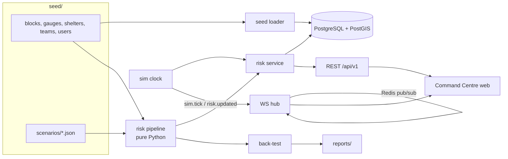

# Architecture

See PRD §4 and §13 for the target system. This page describes what is built.

## Pure core, thin glue

The scoring path has no I/O so it is easy to test and to reuse in the standalone web build (M11):

| Module | Role |
|---|---|
| `risk/engine.py` | PRD §6.4 formula, contributions, driver strings |
| `forecast/nowcast.py` | river level nowcast v1 + least-squares fit of `k` |
| `risk/pipeline.py` | scenario → `AreaInputs` per block/hour; 12 h forecast; early-warning KPI |
| `reports/triage.py` | report AI v1 rules (Appendix 21.3) |
| `sim/scenario.py` | scenario file model (Appendix 21.2) |
| `risk/backtest.py` | recall / false alarms / lead time vs ground truth |

`risk/service.py` loads a scenario, scores all 49 replay hours, stores them in `risk_score`, and serves
"latest" for the sim clock's hour. `sim/clock.py` advances the clock (default 20 real seconds per sim hour
at 1×) and broadcasts over `ws/hub.py`, which fans out locally and across processes via Redis.

## Data model

All PRD §14 tables exist (`app/models.py`, migration `alembic/versions/*_initial_schema.py`), plus
`data_source` for adapter selection and freshness. IDs are bigint. Geometry is SRID 4326 with GiST
indexes. `audit_log` rejects UPDATE/DELETE via trigger.

## Block polygons

Official block boundaries were not available, so blocks are Voronoi cells of approximate centroids,
clipped to a schematic district outline (`app/seed/voronoi.py`), and flagged
`geometry_source='voronoi_approx'`. `scripts/import_boundaries.py` (to be written) will replace them.
